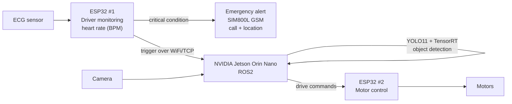

# Autonomous Emergency-Response Vehicle

**A vehicle safety system that watches the driver's heart, safely pulls the car over if the driver has a medical emergency, and calls for help with the car's location.**

Capstone project · B.Sc. Automotive Mechatronics Engineering · German International University (GIU)

---

## The problem

A driver who suddenly has a heart problem or falls asleep can lose control of the car in seconds. Most cars only react after a crash. This project reacts **before**: it detects the emergency, stops the car safely and gets help.

## How it works

1. **Monitor:** ESP32 #1 reads the driver's ECG and calculates the heart rate in real time. An OLED screen shows the live ECG and BPM.
2. **Detect:** if the heart rate shows an abnormal pattern (drowsiness or medical distress), a buzzer countdown starts so a healthy driver can cancel a false alarm.
3. **Alert:** if not cancelled, the system places an automated emergency call and sends the vehicle's location to emergency contacts through a SIM800L GSM module.
4. **Pull over:** ESP32 #1 sends a trigger to the Jetson Orin Nano over WiFi/TCP. ROS2 nodes plan a safe stop, and ESP32 #2 drives the motors to pull over and park, with no input from the driver.
5. **See:** a camera feeds YOLO11 object detection, optimized with TensorRT, so the car can detect objects around it while parking.

## Hardware

| Component | Role |
| --- | --- |
| ESP32 #1 | Driver monitoring: ECG reading, heart-rate (BPM) detection, OLED display, buzzer countdown |
| ECG sensor | Measures the driver's heart signal |
| SIM800L GSM module | Emergency call and location message |
| ESP32 #2 | Motor control for the pull-over and parking manoeuvre |
| NVIDIA Jetson Orin Nano (JetPack 6.1) | Runs ROS2, path planning and YOLO object detection |
| Camera | Vision input for object and lane detection |

## Software

| Part | Details |
| --- | --- |
| Firmware | C/C++ on ESP32 (LEDC PWM, GSM, WiFi/TCP communication) |
| ROS2 nodes (Python) | `trigger_bridge_node` receives the emergency trigger from the ESP32; `planner_node` plans the safe stop |
| Object detection | YOLO11s exported to a TensorRT engine and benchmarked on the Jetson Orin Nano |
| Simulation | Gazebo world with the vehicle URDF, used to test autonomous parking and lane detection before running on hardware |

## My contributions

- Migrated the ESP32 firmware to the new LEDC API and integrated the SIM800L GSM module
- Built the WiFi/TCP link between the ESP32 controllers and the Jetson
- Developed the ROS2 trigger-bridge and planner nodes
- Set up YOLO with TensorRT on the Jetson Orin Nano, exported and benchmarked the models, and chose YOLO11s for ROS integration
- Built the ECG medical-alert subsystem (OLED display, BPM detection, buzzer countdown, emergency call)
- Debugged the Gazebo world and URDF (wheel collision geometry) and rewrote the lane-detection vision pipeline

## Code

The source code (ESP32 firmware, ROS2 workspace and vision pipeline) is being cleaned up and will be published in this repository.

## Author

**Ahmed Mohamed Elanany** · [LinkedIn](https://www.linkedin.com/in/ahmed-elanany) · ahmedelanany34@gmail.com
