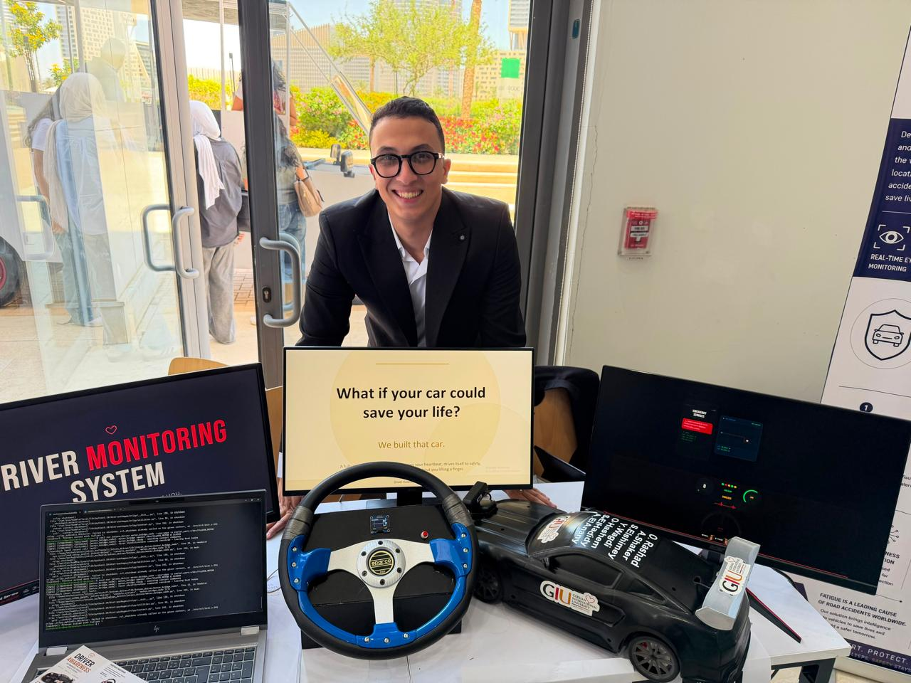
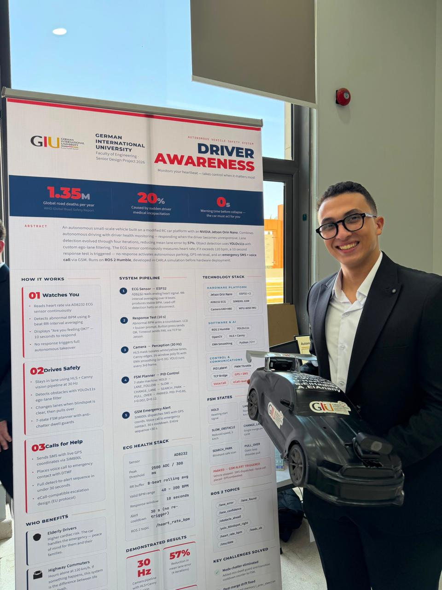
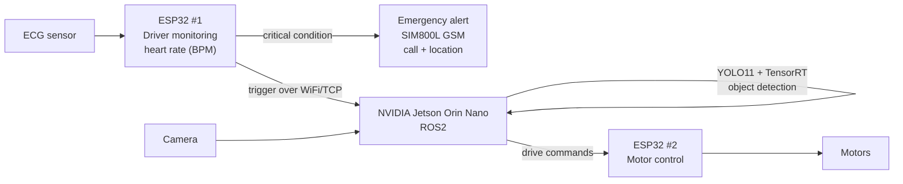
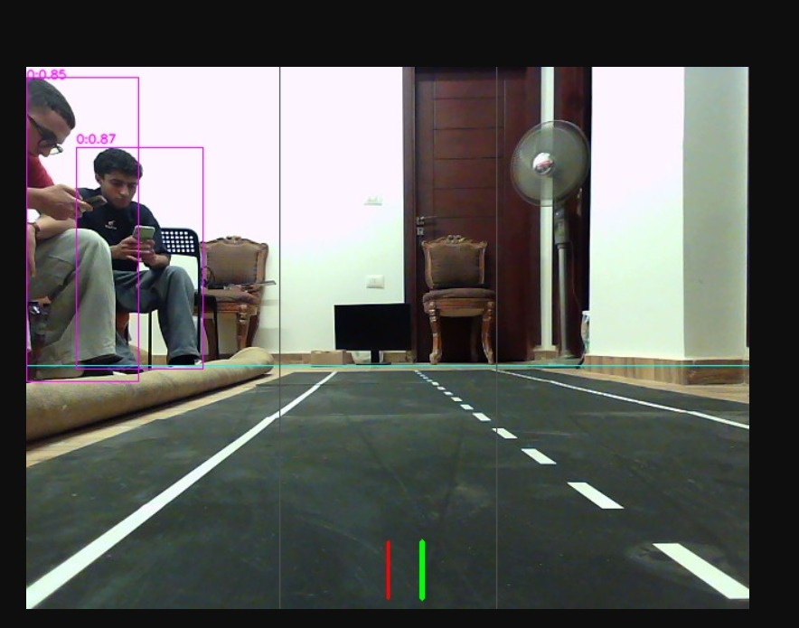

# Autonomous Emergency-Response Vehicle

**A vehicle safety system that watches the driver's heart, safely pulls the car over if the driver has a medical emergency, and calls for help with the car's location.**

Capstone project · B.Sc. Automotive Mechatronics Engineering · German International University (GIU)

  
  &nbsp;
  

---

## About the project

A car with a full AI system that takes over when the driver passes out while driving. A heart-rate (ECG) sensor on the steering wheel monitors the driver all the time. If the driver doesn't respond, the AI system steers the car by itself to a safe place on the right side of the road and stops. It then sends an SMS with the location coordinates and calls the emergency contact with a loud emergency beeping sound.

The **NVIDIA Jetson Orin Nano** is the brain of the car: it runs the camera with YOLO object and lane detection (TensorRT) and ROS2, plans the safe pull-over, and sends the driving commands to the motor controller.

## The problem

A driver who suddenly has a heart problem or falls asleep can lose control of the car in seconds. Most cars only react after a crash. This project reacts **before**: it detects the emergency, stops the car safely and gets help.

## How it works

1. **Monitor:** ESP32 #1 reads the driver's ECG and calculates the heart rate in real time. An OLED screen on the steering wheel shows the live ECG and BPM.
2. **Detect:** when the response test starts, the driver has a few seconds to press a button on the wheel. If not, a buzzer countdown starts so a healthy driver can still cancel a false alarm.
3. **Pull over:** if nobody cancels, ESP32 #1 sends a trigger to the Jetson Orin Nano over WiFi/TCP. ROS2 nodes plan a safe stop, and ESP32 #2 drives the motors to pull over and park, with no input from the driver.
4. **Alert:** once the car is parked, the system sends an SMS with the location and calls the emergency contact through a SIM800L GSM module.
5. **See:** a camera feeds YOLO11 object detection, optimized with TensorRT, so the car can detect objects and lanes around it.

  

## Demo videos

- [Demo 1](videos/demo_1.mp4)
- [Demo 2](videos/demo_2.mp4)
- [Demo 3](videos/demo_3.mp4)

## Hardware

| Component | Role |
| --- | --- |
| ESP32 #1 | Driver monitoring: ECG reading, heart-rate (BPM) detection, OLED display, buttons, buzzer |
| AD8232 ECG sensor | Measures the driver's heart signal |
| SH1106 1.3" OLED (I2C) | Live ECG graph, BPM value and countdown on the steering wheel |
| SIM800L GSM module | Emergency SMS with location and emergency call |
| ESP32 #2 | Motor control for the pull-over and parking manoeuvre |
| NVIDIA Jetson Orin Nano (JetPack 6.1) | Runs ROS2, path planning and YOLO object detection |
| Camera | Vision input for object and lane detection |

### ESP32 #1 pin map

| Part | Pins |
| --- | --- |
| AD8232 ECG | OUT → GPIO 34, LO+ → GPIO 33, LO− → GPIO 25 |
| SIM800L | TX → GPIO 27, RX → GPIO 26 |
| SH1106 OLED | SDA → GPIO 21, SCL → GPIO 22 |
| Response button | GPIO 13 (active low, internal pull-up) |
| Cancel button | GPIO 15 (active low, internal pull-up) |
| Status LED | GPIO 14 |
| Buzzer | GPIO 32 |

## Software

| Part | Details |
| --- | --- |
| Firmware | C/C++ on ESP32 (U8g2 OLED, GSM, WiFi/TCP communication) |
| ROS2 nodes (Python) | `trigger_bridge_node` receives the emergency trigger from the ESP32; `planner_node` plans the safe stop |
| Object detection | YOLO11s exported to a TensorRT engine and benchmarked on the Jetson Orin Nano |
| Simulation | Gazebo world with the vehicle URDF, used to test autonomous parking and lane detection before running on hardware |

## My contributions

- Migrated the ESP32 firmware to the new LEDC API and integrated the SIM800L GSM module
- Built the WiFi/TCP link between the ESP32 controllers and the Jetson
- Developed the ROS2 trigger-bridge and planner nodes
- Set up YOLO with TensorRT on the Jetson Orin Nano, exported and benchmarked the models, and chose YOLO11s for ROS integration
- Built the ECG medical-alert subsystem (OLED display, BPM detection, buzzer countdown, emergency call)
- Debugged the Gazebo world and URDF (wheel collision geometry) and rewrote the lane-detection vision pipeline

## Code

| Folder | What is inside |
| --- | --- |
| [`esp32/esp1_driver_awareness/`](esp32/esp1_driver_awareness) | ESP32 #1: ECG, BPM, OLED, response and cancel buttons, buzzer, SIM800L, link to the Jetson (U8g2 library) |
| [`esp32/esp1_driver_awareness_v2/`](esp32/esp1_driver_awareness_v2) | ESP32 #1, version 2: median-filtered BPM, auto-scaling ECG graph with BPM, 5 s response test with a beeping buzzer (Adafruit SH110X library) |

Before uploading to the ESP32, set your Wi-Fi name and password, the Jetson IP, the emergency phone number and the location in the SMS text.

The motor-control firmware, the ROS2 workspace and the vision pipeline will be added soon.

## Author

**Ahmed Mohamed Elanany** · [LinkedIn](https://www.linkedin.com/in/ahmed-elanany) · ahmedelanany34@gmail.com
